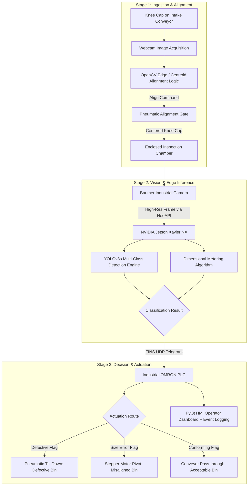
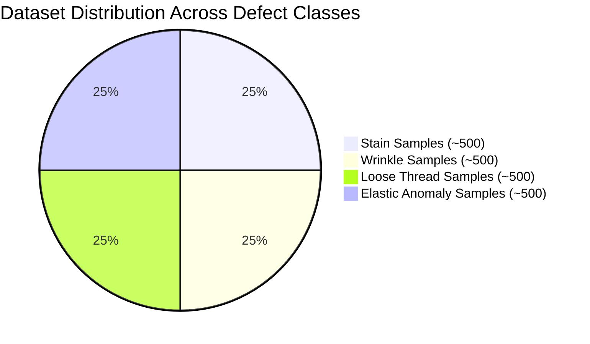
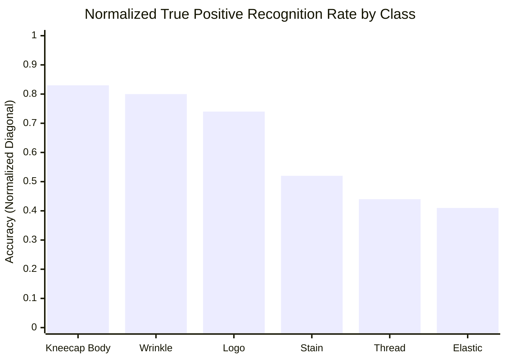
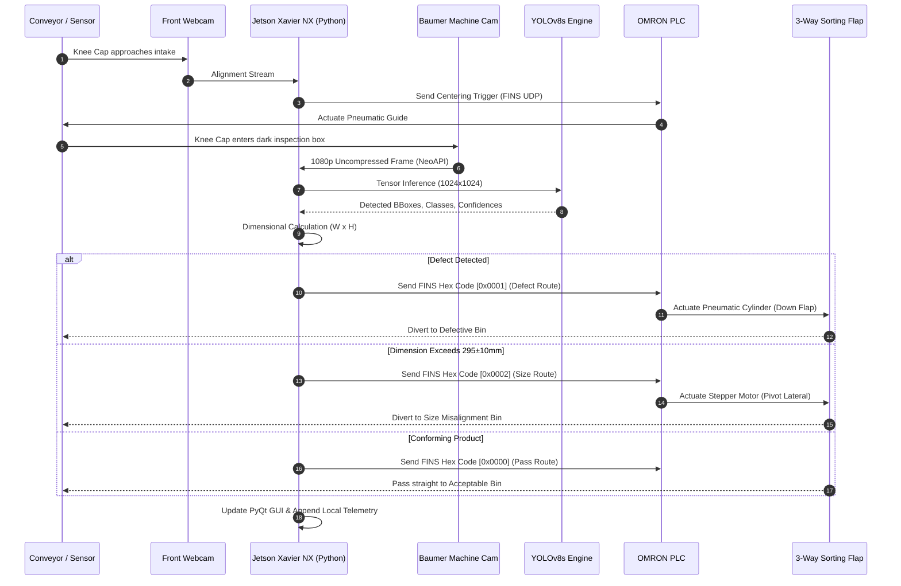

# Design & Evaluation of an Intelligent Visual Inspection System for Fabric Knee Caps

[](https://github.com)
[-blue.svg)](https://github.com/ultralytics/ultralytics)
[](https://developer.nvidia.com/embedded/jetson-xavier-nx)
[]()
[-gold.svg)]()

> **Academic Research Project Report — Module-II (Course AIP252: Co-op Project at Industry)**  
> **Institution:** Department of Computer Science & Engineering (Artificial Intelligence), Chitkara University Institute of Engineering & Technology, Chitkara University, Punjab  
> **Author & Lead Developer:** [Priyansh Gupta](https://github.com/) (Roll No: 2110993823, BE-CSE AI)  
> **Supervised by:** Dr. Sushil Narang (Dean, CSE-AI)  
> **Mentorship & Leadership:** Dr. P. K. Khosla (Pro VC - Research)  
> **Project Team Members:** Priyansh Gupta, Akshit Narwal, Sameep Rohilla, Tarush Arya  
> **Award & Recognition:** Recognized at the **Global AI Summit & National Awards, New Delhi, 2025**

---

## 📑 Table of Contents
1. [Executive Summary & Abstract](#-executive-summary--abstract)
2. [Problem Statement & Industrial Motivation](#-problem-statement--industrial-motivation)
3. [The Inspected Product: Fabric Knee Cap](#-the-inspected-product-fabric-knee-cap)
4. [End-to-End System Architecture](#-end-to-end-system-architecture)
   - [Three-Stage Physical Pipeline](#three-stage-physical-pipeline)
   - [Hardware & Electrical Interfacing](#hardware--electrical-interfacing)
   - [System Architecture Flowchart](#system-architecture-flowchart)
5. [Data Engineering & Annotation Protocols](#-data-engineering--annotation-protocols)
   - [Image Acquisition Setup](#image-acquisition-setup)
   - [Dataset Composition & Augmentation Strategy](#dataset-composition--augmentation-strategy)
   - [Labeling Ontology & Bounding Box Rules](#labeling-ontology--bounding-box-rules)
6. [Machine Learning Pipeline & Model Training](#-machine-learning-pipeline--model-training)
   - [Selection of YOLOv8s Architecture](#selection-of-yolov8s-architecture)
   - [Training Environment & Hyperparameters](#training-environment--hyperparameters)
   - [Training Loss & Performance Metrics](#training-loss--performance-metrics)
   - [Confusion Matrix & Classwise Dissection](#confusion-matrix--classwise-dissection)
7. [Edge Deployment & Hardware-Software Synchronization](#-edge-deployment--hardware-software-synchronization)
   - [NVIDIA Jetson Xavier NX Setup](#nvidia-jetson-xavier-nx-setup)
   - [Dual-Camera Interface & NeoAPI](#dual-camera-interface--neoapi)
   - [PLC Communication via OMRON FINS Protocol over UDP](#plc-communication-via-omron-fins-protocol-over-udp)
   - [PyQt Operator HMI Dashboard & Finite State Machine](#pyqt-operator-hmi-dashboard--finite-state-machine)
8. [Experimental Results & Dimensional Estimation](#-experimental-results--dimensional-estimation)
9. [Challenges, Root Cause Analysis & Mitigations](#-challenges-root-cause-analysis--mitigations)
10. [Comparative Analysis with Related Work](#-comparative-analysis-with-related-work)
11. [Conclusion & Future Roadmap](#-conclusion--future-roadmap)
12. [Author's Contribution & Project Credits](#-authors-contribution--project-credits)
13. [References](#-references)

---

## 📌 Executive Summary & Abstract

Traditional quality assurance in medical and apparel textile manufacturing relies heavily on manual human visual inspection, introducing high operational overhead, cognitive fatigue, subjectivity, and lack of real-time traceability. 

This project delivers an **autonomous, conveyor-based intelligent visual inspection and physical segregation system** engineered specifically for fabric knee caps. The end-to-end cyber-physical architecture integrates:
- **Dual-camera optical vision**: Low-resolution incoming orientation camera paired with a high-resolution Baumer industrial machine vision camera (via NeoAPI).
- **Edge Artificial Intelligence**: Real-time object detection and anomaly segmentation using an optimized **YOLOv8s** deep convolutional neural network deployed on an **NVIDIA Jetson Xavier NX** embedded computer.
- **Automated Dimensional Verification**: Lay-flat geometry estimation (295 ± 10 mm length tolerance check) directly from calibrated visual masks/bounding boxes.
- **Programmable Logic Controller (PLC) Control**: Industrial-grade synchronization over Ethernet using **FINS protocol over UDP**, driving a pneumatic lateral aligner gate and a three-way electro-pneumatic/stepper tilt sorting flap.

The system segregates items into **Defective**, **Acceptable**, and **Size Misaligned** collection bins in real time while logging structured telemetry into an operator-facing PyQt graphical interface.

```
       CONVEYOR INTAKE
              │
              ▼
   ┌───────────────────────┐
   │ Low-Res Alignment Cam │ ──(Webcam / OpenCV)──► Pneumatic Aligner (PLC)
   └───────────────────────┘
              │ (Centered & Aligned)
              ▼
   ┌───────────────────────┐
   │ Darkened Optical Box  │ ──(NeoAPI / 1080p)───► Edge YOLOv8s Inference
   │ (Baumer Machine Cam)  │                        + Dimensional Metering
   └───────────────────────┘
              │
              ▼
   ┌───────────────────────┐
   │ FINS / UDP Signaling  │ ──(Hex Bit Mapping)──► Industrial PLC
   └───────────────────────┘
              │
              ├───────────────────┬───────────────────┐
              ▼                   ▼                   ▼
      [ ACCEPTABLE BIN ]  [ DEFECTIVE BIN ]  [ SIZE MISALIGNMENT ]
```

---

## 🎯 Problem Statement & Industrial Motivation

### Limitations of Conventional Manual Inspection
1. **Human Fatigue & Cognitive Drift:** Inspectors experience visual strain and cognitive exhaustion during repetitive shift work, leading to high false-acceptance rates (FAR) where non-conforming items slip through to end consumers.
2. **Throughput Bottlenecks & High Labor Costs:** Individual manual handling throttles high-speed production lines, requiring multi-operator redundancy and inflating direct cost-per-unit.
3. **Subjective Evaluation Criteria:** Human inspectors apply inconsistent standards to borderline elastic folds, subtle discolorations, or loose stitching.
4. **Lack of Closed-Loop Feedback:** Manual checks generate zero structured real-time metrics. Plant engineers cannot instantly trace whether yarn tensioning, circular knitting machines, or thermal sealing causes an uptick in scrap rates.

### The Proposed Automated Solution
An integrated industrial vision system that unifies high-speed edge deep learning with robust mechanical handling:
- Standardizes inspection cycle time across all operational shifts.
- Provides 100% inline inspection coverage with objective classification thresholds.
- Segregates units mechanically without operator intervention.
- Captures granular event logs (defect frequency, size histograms, cycle timestamps) to drive root-cause manufacturing diagnostics.

---

## 🩼 The Inspected Product: Fabric Knee Cap

The target subject is an orthopedic compression fabric knee cap engineered to deliver uniform, graduated joint support.

```
                 ▲
                 │  Proximal Elastic Band (Mid-Thigh Grip)
          ┌──────┴──────┐
          │ ~ ~ ~ ~ ~ ~ │  <--- Spandex / Lycra Elastic Border
          │             │
          │   ( TYNOR ) │  <--- Brand Logo Region
          │             │
          │   .-----.   │
          │  /  ( )  \  │  <--- Soft Patellar Contoured Relief Zone
          │  \       /  │       (Relieves localized patellar pressure)
          │   '-----'   │
          │             │
          │             │  <--- Breathable Circular Knit Body
          │ ~ ~ ~ ~ ~ ~ │  <--- Distal Elastic Band (Calf Border)
          └──────┬──────┘
                 │
                 ▼  Target Un-stretched Length: 295 mm ± 10 mm
```

### Material & Structural Composition
- **Inner Lining:** Moisture-wicking, breathable knit fabric for skin contact comfort.
- **Exterior Shell:** Resilient, high-tenacity nylon yarn providing structural elasticity.
- **Core Reinforcement:** Integrated elastomeric spandex (polyurethane-polyurea copolymer) threads supplying graduated radial compression.
- **Patellar Relief Zone:** Specialized contour weave engineered to relieve localized kneecap pressure while stabilizing patellar tracking.

### Dimensions & Tolerances
- **Clinical/Commercial Fit:** Measured by circumference at the mid-thigh (15.2 cm superior to the center of the patella).
- **Manufacturing Lay-Flat Benchmark:** Un-stretched static length of **$295 \pm 10\text{ mm}$** ($285\text{ mm}$ to $305\text{ mm}$) and flat width of **$140\text{ to }160\text{ mm}$**.

### Defect Taxonomy
The system inspects for four major anomaly categories that impair structural efficacy or aesthetics:

| Defect Class | Physical Characteristics | Root Cause in Manufacturing | Functional/Aesthetic Impact |
| :--- | :--- | :--- | :--- |
| **`stain`** | Oil marks, localized discoloration, dye smudges | Machine lubrication leaks, operator handling, dyeing inconsistency | Rejection on cosmetic and hygienic grounds |
| **`thread`** | Uncut or protruding thread loops, loose stitching, frayed yarn | Dull trimming cutters, broken sewing needles, thread tension mismatch | Risk of unraveling seams; poor finish |
| **`wrinkle`** | Creasing, surface puckering, gathered fabric | Irregular knitting take-down tension, improper heat-setting | Compromised aesthetic finish; non-uniform compression |
| **`elastic`**| Distorted elastomeric borders, warped rims, ruptured spandex cords | Uneven yarn feed during ribbing, tension drop in spandex spool | Loss of compressive elasticity; sizing failure; sliding fit |

---

## 🏗️ End-to-End System Architecture

The complete system spans physical mechanics, digital acquisition, neural inference, and industrial PLC control divided into three sequential processing stages:



### Three-Stage Physical Pipeline
1. **Alignment Stage:** An entry-level CMOS webcam tracks the raw posture of the knee cap as it arrives from the feeder. A lightweight OpenCV contour/centroid algorithm calculates lateral deviation and commands an intake pneumatic guide to re-orient the product centrally on the conveyor belt.
2. **Inspection Stage:** The knee cap enters a darkened, matte-black optical enclosure equipped with soft diffuse overhead LED lighting to eradicate specular highlights and shadows. A top-mounted **Baumer machine vision camera** captures a crisp 1080p top-down image triggered upon entry.
3. **Sorting Stage:** The edge application dispatches the inspection decision to an industrial PLC. The PLC triggers a high-speed three-way tilt assembly combining pneumatic cylinders and precision stepper motors to route the article into the correct bin.

### Hardware & Electrical Interfacing

```mermaid
graph LR
    subgraph Optical["Optical Subsystem"]
        CAM1[Webcam - Front Alignment]
        CAM2[Baumer Industrial Camera - 1080p]
    end

    subgraph Compute["Edge Processing Core"]
        JETSON[NVIDIA Jetson Xavier NX<br/>Ubuntu Linux + JetPack 5.1.1<br/>CUDA 11.4 + TensorRT / PyTorch<br/>PyQt HMI Dashboard]
    end

    subgraph Industrial["PLC & Automation Control"]
        PLC[OMRON Industrial PLC<br/>Ethernet Interface (UDP Port 9600)<br/>Memory Relay Bits]
        ACT1[Pneumatic Aligner Cylinder]
        ACT2[Pneumatic Tilt Actuator]
        ACT3[Precision Stepper Motor]
        INDICATOR[3-Color Tower Light<br/>Red=Halted, Amber=Paused, Green=Running]
    end

    CAM1 -- USB Video Stream --> JETSON
    CAM2 -- GigE / USB3 via NeoAPI --> JETSON
    JETSON -- FINS Protocol over UDP --> PLC
    PLC --> ACT1
    PLC --> ACT2
    PLC --> ACT3
    PLC --> INDICATOR
```

---

## 📊 Data Engineering & Annotation Protocols

### Image Acquisition Setup
- **Imaging Device:** High-speed Baumer industrial CMOS camera mounted orthogonally at a fixed distance of **$1.0\text{ meter}$** above the conveyor bed.
- **Illumination:** Diffuse overhead planar LED panel providing balanced, high CRI (>90) illumination without hot spots.
- **Background:** High-contrast, non-reflective matte-black conveyor belt substrate.
- **Dual-Surface Imaging:** Every physical knee cap sample was photographed on both its **anterior (front)** and **posterior (back)** sides, capturing the logo, patellar contour, side seams, and elastic ribbing.

### Dataset Composition & Augmentation Strategy
- **Base Cohort:** ~100 distinct physical defective knee caps per defect class (400 base samples).
- **Augmentation Pipeline:** To emulate belt vibration, slight skewing, and varying line speeds, an augmentation routine expanded the dataset to **~500 image variants per category** (~2,000+ total annotated frames):
  - **Geometric:** Rigid $180^\circ$ rotation, horizontal flips, random scaling between 1080p and 720p.
  - **Photometric:** Contrast jitter ($\pm 15\%$), brightness perturbations, slight Gaussian noise.
  - **Motion Simulation:** Motion blur kernel injection to simulate moving conveyor belt artifacts.
- **Dataset Partitioning:**
  - **Training Set:** $70\%$ (feature extraction and weight updates)
  - **Testing Set:** $20\%$ (unseen held-out evaluation)
  - **Validation Set:** $10\%$ (hyperparameter tuning and checkpoint selection)



### Labeling Ontology & Bounding Box Rules
Images were annotated using **LabelImg** following standardized annotation rules:
1. `kneecap`: Bounding box enclosing the entire outer perimeter of the product (used for dimensional checks and spatial localization).
2. `logo`: Bounding box enclosing the corporate trademark emblem.
3. `stain`: Tight bounding box enclosing oil spots, dirt, or localized dye variations.
4. `thread`: Bounding box enclosing loose, protruding, or tangled thread filaments.
5. `wrinkle`: Bounding box covering gathered or puckered fabric sections.
6. `elastic`: Bounding box targeting irregular, wavy, or detached elastic bands.

**Annotation Guidelines:**
- Tight bounding boxes enclosing the full extent of the defect without excessive background margins.
- Multi-instance segregation: If multiple distinct stains or threads appear, each is annotated with its own individual bounding box.

---

## 🧠 Machine Learning Pipeline & Model Training

### Selection of YOLOv8s Architecture
YOLOv8 (Ultralytics) was chosen over two-stage detectors (e.g., Faster R-CNN) and older YOLO variants due to:
1. **Single-Stage Real-Time Throughput:** Unifies localization and classification in a single forward pass, easily achieving $>30\text{ FPS}$ on edge devices.
2. **Anchor-Free Split Detection Head:** Eliminates predefined anchor boxes, significantly improving sensitivity to objects of variable aspect ratios (such as thin thread filaments and elongated wrinkles).
3. **C2f Cross-Stage Feature Fusion:** Integrates gradient flow branches that combine low-level high-resolution texture details (critical for subtle stains and threads) with high-level semantic context (identifying the entire knee cap body).

```
   INPUT IMAGE (1024 x 1024 x 3)
                │
                ▼
   ┌─────────────────────────────┐
   │    YOLOv8 BACKBONE (CSP)    │  Extracts hierarchical features
   │   Conv -> C2f -> SPPF       │  at P3, P4, P5 resolution levels
   └─────────────────────────────┘
                │
                ▼
   ┌─────────────────────────────┐
   │     PAN-FPN PATH NECK       │  Multi-scale bi-directional
   │  Top-Down + Bottom-Up C2f   │  feature concatenation
   └─────────────────────────────┘
                │
                ├───────────────────────────────┐
                ▼                               ▼
   ┌─────────────────────────┐     ┌─────────────────────────┐
   │   Bounding Box Head     │     │   Classification Head   │
   │   (CIoU + DFL Loss)     │     │     (BCE Loss)          │
   └─────────────────────────┘     └─────────────────────────┘
```

### Training Environment & Hyperparameters
- **Workstation:** Dell Precision Tower Pro Workstation
- **Processor:** Intel® Xeon® Enterprise Processor
- **Accelerator:** NVIDIA® RTX™ A4000 Ada Generation GPU (16 GB GDDR6)
- **Host Memory:** 128 GB DDR4 RAM | 2 TB NVMe Solid State Storage
- **Hyperparameter Specifications:**
  - **Model Variant:** `yolov8s.pt` (Small checkpoint, balancing edge latency and feature richness)
  - **Epochs:** $100$
  - **Batch Size:** $8$
  - **Input Image Resolution:** $1024 \times 1024$ pixels
  - **Optimizer:** AdamW / SGD with cosine learning rate scheduling
  - **Total Training Duration:** $8 - 10\text{ hours}$

### Training Loss & Performance Metrics

| Evaluation Metric | Mathematical Definition | Experimental Score | Analysis |
| :--- | :--- | :--- | :--- |
| **Precision ($P$)** | $\frac{TP}{TP + FP}$ | **$0.60$** ($60.0\%$) | Reflects strictness against false positives; conservative alarm rate |
| **Recall ($R$)** | $\frac{TP}{TP + FN}$ | **$0.57$** ($57.0\%$) | Reflects capability to catch true defects; suppressed by faint threads/stains |
| **mAP @ 0.50 IoU** | $\int_0^1 P(R) dR$ | **$0.61$** ($61.0\%$) | Reliable detection across standard intersection-over-union thresholds |
| **mAP @ 0.50:0.95**| Mean across IoU $[0.50, 0.95]$ | **$0.45$** ($45.0\%$) | Solid localization quality under strict spatial overlap limits |

### Confusion Matrix & Classwise Dissection



- **Knee Cap Localization ($0.83$):** Outstanding identification of whole product boundaries, providing a dependable anchor for dimensional measurements.
- **Wrinkles ($0.80$):** High accuracy due to distinct shadowing, displacement of regular knit rib lines, and high contrast against the fabric body.
- **Stains ($0.52$):** Moderate detection. Faint or diffused oil spots frequently blend into the nylon weave, resulting in background misclassifications.
- **Threads ($0.44$) & Elastic Anomalies ($0.41$):** Slender filament widths ($<1\text{ mm}$) and localized edge distortion proved most susceptible to false negatives and motion blur.

---

## ⚡ Edge Deployment & Hardware-Software Synchronization



### NVIDIA Jetson Xavier NX Setup
- **Operating Environment:** Ubuntu 20.04 LTS flashed with **NVIDIA JetPack 5.1.1 (Rev 1)** via NVIDIA SDK Manager.
- **Acceleration Stack:** CUDA 11.4, cuDNN 8.6, TensorRT runtime.
- **Storage Configuration:** Expanded NVMe SSD to support continuous frame buffering and model weight caching.

### Dual-Camera Interface & NeoAPI
- **Alignment Vision:** Front-facing webcam stream handled via OpenCV `cv2.VideoCapture` thread.
- **High-Resolution Inspection:** Baumer industrial camera controlled through the hardware-native **NeoAPI** Python SDK, enabling sub-millisecond shutter control, manual exposure adjustment (minimizing motion blur), and raw sensor format conversion.

### PLC Communication via OMRON FINS Protocol over UDP
The Jetson communicates with the OMRON PLC over industrial Ethernet using **Factory Interface Network Service (FINS)** frames encapsulated inside UDP packets:
- **Port:** UDP `9600`
- **Memory Allocation:** Jetson writes directly to designated Direct Memory (DM) allocation registers.
- **Command Structure:**
  - `0x0000`: Conformity Verified (Route to Acceptable Bin)
  - `0x0001`: Anomaly Flagged (Route to Defective Bin via pneumatic tilt plate drop)
  - `0x0002`: Dimension Out-of-Spec (Route to Size Misaligned Bin via stepper motor lateral deflection)
- **Bidirectional Polling:** The Python daemon continuously reads machine status bits (e.g., conveyor running, optical photo-interrupter tripped, emergency stop).

### PyQt Operator HMI Dashboard & Finite State Machine
A touchscreen-optimized PyQt GUI displays:
- Real-time video feed with overlaid bounding boxes, class names, and confidence scores.
- Aggregate piece-part counters (Total Inspected, Pass Count, Reject Count, Size Reject Count).
- Defect Pareto breakdown (live counts of stains, loose threads, wrinkles, and elastic faults).
- System health status synchronized with the physical 3-color light stack:
  - 🔴 **Red:** Machine Halted / Safety Interlock Open
  - 🟡 **Amber:** System Paused / Sensor Calibration
  - 🟢 **Green:** Fully Automatic In-Line Inspection Active

---

## 📈 Experimental Results & Dimensional Estimation

### Edge Inference Performance
- **Localization Confidence:** Across five benchmark operational test frames, target knee caps were isolated with confidence levels between **$93.74\%$ and $98.24\%$** under controlled stationary conditions.
- **In-Machine Operating Confidence:** In active conveyor runs, confidence values consistently registered between **$0.81$ and $0.95$**.
- **Multi-Instance Isolation:** Successfully detected and isolated multiple co-occurring defects within a single capture (e.g., two distinct oil stains alongside a wrinkled boundary).

### Dimensional Metrology Verification
Utilizing calibrated pixel-to-millimeter transformation matrices from the fixed 1-meter optical perspective:
- **Sample Target Reference:** Nominal length of $295\text{ mm}$ ($29.5\text{ cm}$) with a tolerance band of $\pm 10\text{ mm}$.
- **Experimental System Estimates:**
  - Measured Width: **$14.0\text{ cm to }16.0\text{ cm}$** ($140\text{ to }160\text{ mm}$)
  - Measured Length: **$25.0\text{ cm to }30.0\text{ cm}$** ($250\text{ to }300\text{ mm}$)
- **Operational Utility:** Successfully identified skewed, folded, or under-stretched knee caps failing static engineering limits prior to packaging.

---

## ⚠️ Challenges, Root Cause Analysis & Mitigations

```mermaid
graph TD
    subgraph Challenge1["Challenge 1: Motion Blur"]
        C1[Stationary Dataset vs Moving Belt] --> R1[Conveyor velocity induced pixel displacement]
        R1 --> S1[Added in-situ moving conveyor frames into dataset + short camera exposure]
    end

    subgraph Challenge2["Challenge 2: Edge Hardware Integration"]
        C2[ARM64 Jetson + CUDA 11.4] --> R2[Complex toolchain compilation & FINS UDP timing]
        R2 --> S2[JetPack 5.1.1 flashing + decoupled async UDP socket threads]
    end

    subgraph Challenge3["Challenge 3: Product Generalization"]
        C3[Fixed Geometry Constraints] --> R3[Model tailored to single color/size variant]
        R3 --> S3[Modular annotation pipeline for rapid retraining on new variants]
    end
```



### 1. Motion Blur Discrepancy
- **Root Cause:** Initial training data was captured from stationary knee caps placed manually beneath the camera. When deployed on the active conveyor, linear belt velocity introduced microscopic motion smear, decreasing feature contrast for thin threads and small stains.
- **Mitigation:** The team captured operational frames directly from the moving conveyor under production lighting and added them into the training corpus. Camera exposure time was minimized while elevating LED panel illumination intensity.

### 2. Embedded ARM64 & CUDA Optimization
- **Root Cause:** Deploying YOLOv8 on an ARM64-based NVIDIA Jetson Xavier NX required strict driver alignment with CUDA 11.4 and JetPack 5.1.1. Incomplete dependencies caused initial boot and driver initialization failures.
- **Mitigation:** eMMC and NVMe storage were re-partitioned and cleanly reflashed via NVIDIA SDK Manager on an Ubuntu host. Python threads for camera acquisition, inference, and FINS communication were asynchronously decoupled.

### 3. Textile Flexibility & Position Variation
- **Root Cause:** Fabric knee caps are non-rigid elastomeric bodies. Minor bunching or curling alters external boundary dimensions without indicating an actual manufacturing defect.
- **Mitigation:** The upstream pneumatic aligner gate standardizes the lay-flat posture before the item enters the optical box.

---

## 🔬 Comparative Analysis with Related Work

The table below contrasts this project with published benchmarks in automated fabric and conveyor inspection:

| Benchmark Study | Target Specimen | Vision Architecture | Mechanical & Actuation Integration | Throughput & Latency | Reported Metrics |
| :--- | :--- | :--- | :--- | :--- | :--- |
| **Li & Zhu (2024)** | Tianchi Fabric Dataset | PEI-YOLOv5 (Lightweight) | None (Offline Dataset Evaluation only) | $31\text{ FPS}$ on Jetson TX2 | $87.89\%\text{ mAP}$ (difficulties on slender threads) |
| **Yu et al. (2024)** | ZJU-Leaper & NEU-DET | FA-YOLO (YOLOv4 + Feature Fusion) | None (Offline Image Classification only) | Not specified | $72.5\%\text{ mAP}$ on Tianchi; $0.714\text{ F1}$ on ZJU |
| **Teimouri et al. (2018)**| Poultry Cuts | Classical Geometric/Texture ANN | Conveyor belt + Pneumatic Flap | $15\text{ ms}$ processing; $2,800\text{ parts/hr}$ ($0.2\text{ m/s}$) | $93.0\%$ overall separation accuracy |
| **Almtireen et al. (2025)**| Recyclable Waste (Cans/Plastic) | YOLOv8 + OMRON PLC | Conveyor + Multi-Pneumatic Pushers | In-line real-time sorting | $90\% P$, $80\% R$, $86\%\text{ mAP}_{50}$; Sorting: $75\text{--}91\%$ |
| **This Work (Gupta et al.)** | **Fabric Knee Caps (Orthopedic)** | **YOLOv8s + Dual Camera (NeoAPI)** | **Pneumatic Aligner + 3-Way Tilt/Stepper Flap (PLC)** | **In-line real-time edge processing** | **$0.83$ body, $0.80$ wrinkle, $93.7\text{--}98.2\%$ conf., 3-way sort** |

### Key Takeaway
Unlike studies limited to offline dataset analysis (Li & Zhu, Yu et al.), this system completes the closed loop: from raw unaligned material on a moving belt to sub-second deep learning inference, dimensional metering, and physical three-way pneumatic/stepper bin segregation.

---

## 🚀 Conclusion & Future Roadmap

### Project Conclusion
This academic research project successfully designed, prototyped, and evaluated an intelligent, vision-guided inspection and sorting machine for elastic fabric knee caps. By deploying an optimized YOLOv8s object detector on an embedded NVIDIA Jetson Xavier NX synchronized with an industrial PLC over FINS/UDP, the system demonstrates the practical viability of automating visual quality control in apparel and medical textile manufacturing.

### Future Roadmap
1. **Model Optimization with TensorRT:** Quantize the YOLOv8s engine from FP32 to **FP16 / INT8 precision** via TensorRT to double inference frame rates and lower edge thermal dissipation.
2. **High-Speed Strobe Lighting:** Introduce ultra-short microsecond LED strobe illumination synchronized with an optical rotary encoder on the conveyor shaft to eliminate motion blur at line speeds $>0.5\text{ m/s}$.
3. **Telemetric Industry 4.0 Integration:** Connect the Jetson Python runtime to an enterprise cloud / MQTT broker, creating automated Pareto dashboards and instant quality alerts for plant supervisors.
4. **Adaptive Multi-Product Support:** Implement self-supervised transfer learning models to accommodate different knee cap sizes, colorways, and compression brace variants without manual annotation cycles.

---

## 👥 Author's Contribution & Project Credits

### Primary Researcher & System Developer
- **Priyansh Gupta** (Roll No: `2110993823`)  
  *BE - Computer Science & Engineering (Artificial Intelligence)*  
  *Department of Computer Science & Engineering, Chitkara University Institute of Engineering & Technology, Punjab*
  - Designed the end-to-end computer vision and deep learning pipeline.
  - Curated, augmented, and annotated the multi-class textile defect dataset.
  - Configured, trained, and validated the YOLOv8s model on workstation GPU hardware.
  - Flashed, optimized, and deployed edge inference on the NVIDIA Jetson Xavier NX.
  - Engineered the NeoAPI camera acquisition module and the FINS/UDP industrial PLC communication driver.
  - Developed the PyQt touchscreen HMI dashboard and integrated the multi-stage sorting logic.

### Academic Guidance & Institutional Leadership
- **Dr. Sushil Narang** — *Dean, Department of Computer Science & Engineering (Artificial Intelligence)* — Project Supervisor & Technical Guide.
- **Dr. P. K. Khosla** — *Pro Vice-Chancellor (Research), Chitkara University* — Research Mentorship & Advisory.

### Project Team Members
- **Priyansh Gupta** (Lead Developer)
- **Akshit Narwal** (Hardware & Mechanical Collaboration)
- **Sameep Rohilla** (Testing & Data Annotation Support)
- **Tarush Arya** (Electrical & Actuation Integration Support)

### Honors & Industry Recognition
🏆 **Recognized at the Global AI Summit & National Awards, New Delhi (2025)** for innovation in applied industrial artificial intelligence and edge computing robotics.

---

## 📚 References

1. **Almtireen, N., Rawashdeh, N., Reddy, V., Sutton, M., Nedvidek, A., Karn, C., et al. (2025).** PLC-controlled intelligent conveyor system with AI-enhanced vision for efficient waste sorting. *Applied Sciences*, 15(3), 1550. [https://doi.org/10.3390/app15031550](https://doi.org/10.3390/app15031550)
2. **Li, X., & Zhu, Y. (2024).** A real-time and accurate convolutional neural network for fabric defect detection. *Complex & Intelligent Systems*, 10, 3371–3387. [https://doi.org/10.1007/s40747-023-01317-8](https://doi.org/10.1007/s40747-023-01317-8)
3. **Redmon, J., Divvala, S., Girshick, R., & Farhadi, A. (2016).** You only look once: Unified, real-time object detection. *Proceedings of the IEEE Conference on Computer Vision and Pattern Recognition (CVPR)*, 779–788. [https://doi.org/10.1109/CVPR.2016.91](https://doi.org/10.1109/CVPR.2016.91)
4. **Teimouri, N., Omid, M., Mollazade, K., Mousazadeh, H., Alimardani, R., & Karstoft, H. (2018).** On-line separation and sorting of chicken portions using a robust vision-based intelligent modelling approach. *Biosystems Engineering*, 167, 8–20. [https://doi.org/10.1016/j.biosystemseng.2017.12.009](https://doi.org/10.1016/j.biosystemseng.2017.12.009)
5. **Yu, K., Lyu, W., Yu, X., Guo, Q., Xu, W., & Zhang, L. (2024).** FA-YOLO: A high-precision and efficient method for fabric defect detection in textile industry. *IEICE Transactions on Fundamentals of Electronics, Communications and Computer Sciences*, E107.A(6), 890–898. [https://doi.org/10.1587/transfun.2023EAP1030](https://doi.org/10.1587/transfun.2023EAP1030)
